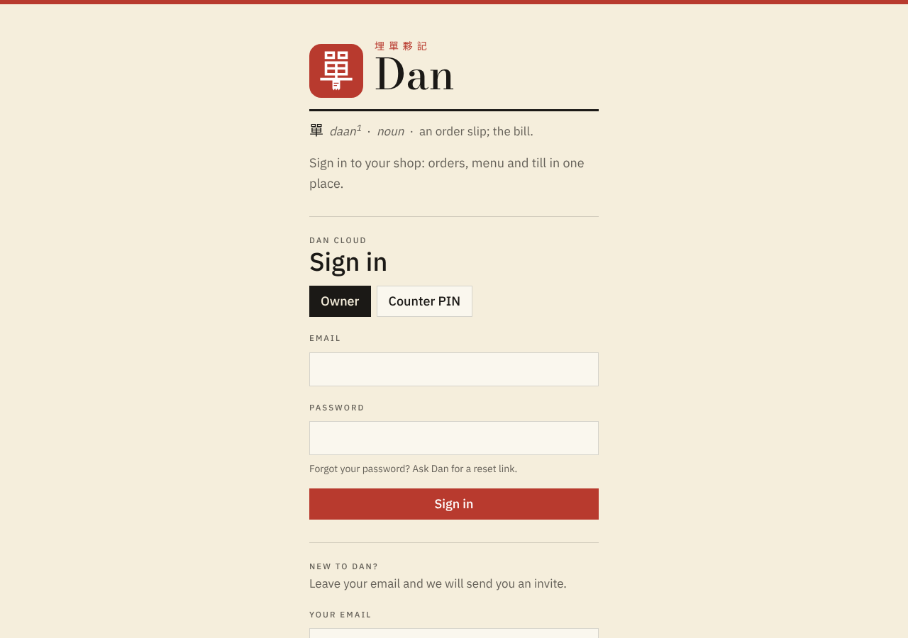
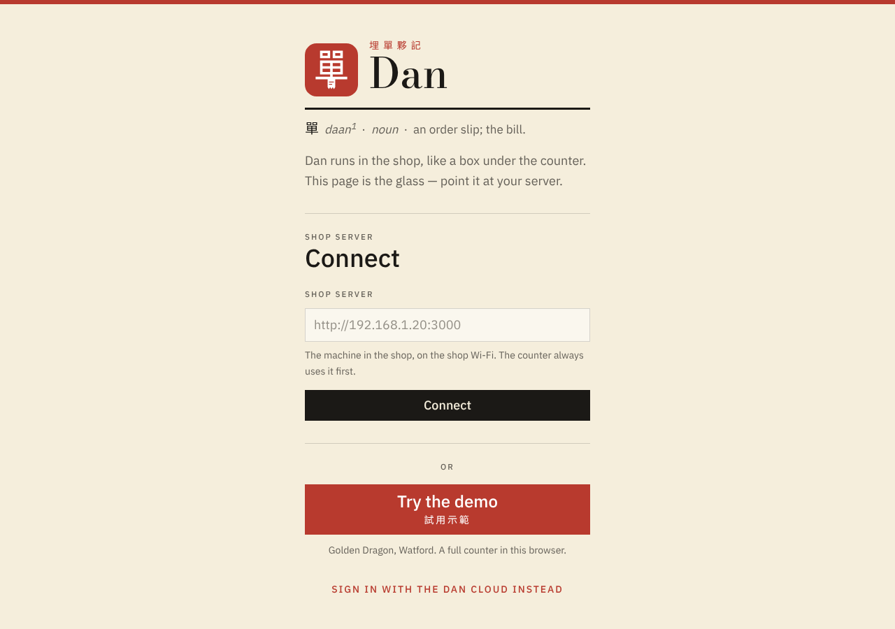
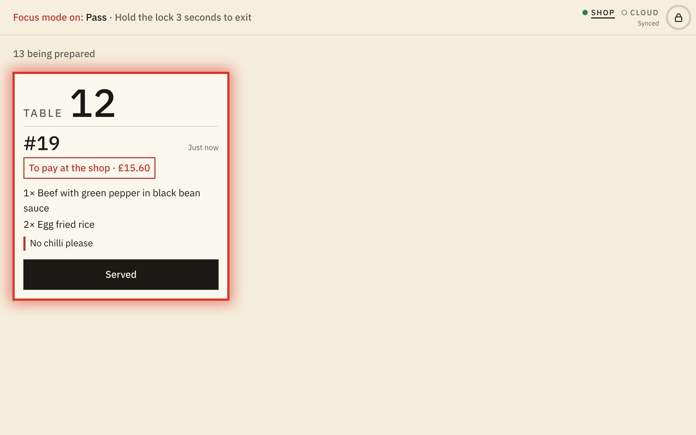
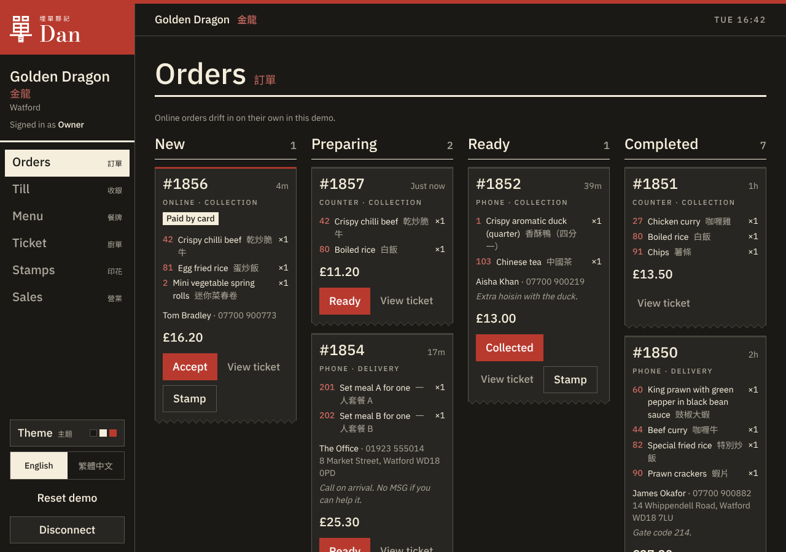

# Dan

Dan (單, Cantonese *daan1*, an order slip) is the counter for a Chinese takeaway. A shop lives in the Dan cloud, and can also run its own Dan server on the premises. This repository is the web client — the glass on the counter — served at [my.dan.partners](https://my.dan.partners). The name is a pun on 埋單夥記.

The client signs in to a shop in the **Dan cloud**, connects to a shop's own server, or opens a full mock of **Golden Dragon, Watford** that lives entirely in the browser.






## Run

```bash
npm install
npm run dev
```

Open [http://localhost:3000](http://localhost:3000).

- **Sign in** (the first page) is for a shop in the Dan cloud: the owner's email and password, or the shop's address name and the counter PIN. Below it, anyone can **join the waiting list** with an email. See [Accounts in the Dan cloud](#accounts-in-the-dan-cloud).
- **Connect** (`/connect`, linked from the first page) asks for the shop server URL (`http://192.168.1.20:2283`, `https://goldendragon.dan.partners`, …), sends a GraphQL `ping` to `<server>/graphql`, remembers recent servers, then asks for email and password or a counter PIN.
- **Try the demo / 試用示範** signs into Golden Dragon with no backend. Orders, the menu, stamp cards and today’s takings persist in `localStorage`. **Reset demo** in the side menu loads the shop again.

```bash
npm test          # mock server, GraphQL client, theme colours and contrast
npm run test:e2e  # connect → demo → till → kitchen ticket, and themes
npm run lint
npm run build
```

## Deploy

**On the shop's machine (how a shop's counter runs it).** The [shop server](https://github.com/DanPartners/server)'s `compose.yaml` builds this repo, pinned to a tested commit, from the `Dockerfile` here (a standalone Next.js build on Node 22, non-root). Its front serves the dashboard and the staff API together at `http://<shop machine>:3000` on the shop's network. The tablets open that address, so the counter works with no internet: every page, font and request stays on the shop's network. The sign-in page fills in the shop server by itself there.

**Hosted (for the owner away from the shop, and the demo).** The app is a Next.js project with no required environment variables (`NEXT_PUBLIC_DAN_CLOUD_URL` is only for a cloud other than `https://cloud.dan.partners`). On Vercel, import this repository (framework preset Next.js) and attach the domain `my.dan.partners`. The demo works as soon as the deployment is live. `https://my.dan.partners/shop/orders?demo=1` opens the demo straight on the orders board (the website links there); someone already signed in to a shop stays signed in.

## Accounts in the Dan cloud

A business joins in the [Dan cloud](https://github.com/DanPartners/cloud), with no machine to set up. The dashboard talks to the cloud's own address for this (`NEXT_PUBLIC_DAN_CLOUD_URL` at build time; `https://cloud.dan.partners` when unset), then to the shop's own staff API, which the cloud hands back.

- **Waiting list.** The first page takes an email (`POST /v1/waitlist`). The answer is the same whoever asks.
- **Invite.** Dan picks people from the list and sends each a one-time link by hand (`dan-cloud waitlist invite <email>`): `/join#<token>`. The page takes the token out of the address bar, then asks for a name, a password (at least 10 characters), the shop's name, its address name (checked as it is typed) and a template: **online shop** (three columns: New, Ready, Completed; no stations, no views, no sounds) or **restaurant** (New, Preparing, Ready, Completed; four stations; Kitchen and Pass; the kitchen's 叮). Everything a template sets can be changed later on the Order board page. The shop is made and the owner is signed in, on an empty menu.
- **Sign in.** Email and password find the owner's shop (`POST /v1/login`). A counter tablet signs in with the shop's address name and PIN; the device remembers the address name.
- **Forgotten password.** Dan sends a one-time link (`dan-cloud shop reset-link <email>`): `/reset#<token>`. Choosing a new password ends the old sign-ins.
- **A shop that lives in the cloud** has one server. The status corner shows one light, "Dan cloud", and there is nothing to sync or switch to.
- **Building the menu** (owner): on Menu, **Add dish**, **Edit categories** (add, rename, put in order, remove an empty one), and **Remove dish** inside a dish. One name is enough for a dish or a category; it is used for both languages. The demo does the same in the browser.
- **Stations** (owner, on the Order board page): add, rename, reorder and remove the shop's stations, or have none. A station with dishes on it cannot be removed. The dish form, the kitchen's filter, tickets and printers follow the list. The counter PIN sees it read-only. `e2e/stations.spec.ts` covers the demo, the PIN and a cloud restaurant with no stations.
- **Views** (owner, on the Order board page): see [Views](#views) below.
- **Tools** (owner): **Shop details** (name, Chinese name, address, town, phone) and **Counter PIN** (set or change it; tablets on the old PIN are signed out).
- Passwords are cleared from a form once it has signed in, because a page already visited can stay in memory.

`e2e/accounts.spec.ts` runs the whole of it against a real cloud: waiting list, an invite made with the cloud's command, joining, building a menu, an order numbered 1, signing in again by email and by PIN, and a reset link. It is skipped unless you point it at a cloud that allows this dashboard's address, with the dashboard built for that cloud:

```bash
NEXT_PUBLIC_DAN_CLOUD_URL=http://localhost:2290 npm run dev
```

```bash
DAN_E2E_ACCOUNTS=1 DAN_E2E_CLOUD=http://localhost:2290 DAN_E2E_CLOUD_BIN=../cloud/target/debug/dan-cloud DAN_E2E_CLOUD_MONGODB_URI=mongodb://127.0.0.1:27017 DAN_E2E_CLOUD_DATABASE=dan_cloud npx playwright test accounts
```

The cloud limits how often one caller may use these pages (5 waiting-list entries an hour), so many reruns in a row are refused, plainly.

## The shop server

A real shop runs [DanPartners/server](https://github.com/DanPartners/server): a Rust server with a local MongoDB, set up with `dan-server init` and run with Docker Compose. The dashboard talks to it over **GraphQL** at `<server>/graphql`. The wire contract is the server's [`schema.graphql`](https://github.com/DanPartners/server/blob/main/schema.graphql); this repo's side is [`src/lib/graphql-client.ts`](src/lib/graphql-client.ts), which implements `DanClient` from [`src/lib/types.ts`](src/lib/types.ts). Screens only see `DanClient`, so the browser demo and a real server look the same to them.

- **Two servers.** The connect page (`/connect`) asks for the **shop server** (required) and the **Dan cloud** (optional: the shop's address on the cloud, `https://<shop>.dan.partners/staff`). Signing in signs in to both. The counter uses the shop server first.
- **Switch-over.** Both servers are checked every 10 seconds (every 3 while something is wrong). If the shop server misses 3 checks in a row while the cloud answers, every request and the live channel move to the cloud, and a strip says so. When the shop server answers 2 checks in a row and reports it has caught up with the cloud, the counter goes back. The rule is `serverInUse` in [`src/lib/server-links.ts`](src/lib/server-links.ts). Orders taken on the cloud are numbered from 9001 if the shop server cannot number them, and sync to it when it returns.
  - **Limit:** the counter page is served by the shop machine. A tablet that already has it open carries on; one that reloads while the machine is down has nothing to reload. Until the counter is cached in the browser, open `my.dan.partners` on any device and enter the shop's cloud address as the shop server.
- **Status, top right.** A light for each server (green connected, amber reconnecting, red offline), the one in use underlined, and the sync line ("Synced", "Waiting to sync: 12 changes", or "Sync not running yet"). Tap for the addresses and the last sync. Both servers are checked every 10 seconds; a server is offline after three missed checks. Any staff member sees it.
- **Connect** sends `ping`. The answer must say `product: "dan"`. A server that has not run `init` answers `not_set_up`, and the connect screen says so.
- **Sign in** with the owner's email and password, or the counter PIN. The token goes in `Authorization: Bearer <token>`.
- **Live, over a WebSocket.** After sign-in the dashboard opens the server's live channel (`<server>/graphql/ws`, the standard `graphql-transport-ws` protocol) and sends its token in the first message. New and moved orders arrive at once, in full; a menu, stamp card or theme change arrives as a notice and the dashboard fetches just that part. Nothing polls. If the connection drops, the dashboard shows that the shop server is not answering, reconnects by itself, and fetches everything again so nothing is missed. The client is [`src/lib/live.ts`](src/lib/live.ts), shared with the customer site. A new online order shows a banner, as in the demo.
- **The counter PIN runs service**: orders, the till, tickets, stamp cards, and marking dishes sold out. Only the owner edits dishes and prices or sees sales. The server enforces this. The dashboard hides the Sales link, makes dish rows read-only and explains why, so nobody hits an error mid-rush. The side menu shows who is signed in.
- **Online orders** from the customer site show how they are paid: "Paid by card", or "To pay at the shop" with the amount, on the docket and on the ticket.
- **Errors** carry the server's code (`forbidden`, `locked`, `sold_out` …), and [`src/lib/i18n.ts`](src/lib/i18n.ts) turns it into copy.
- The server must list a hosted dashboard's address in `DAN_ALLOWED_ORIGINS`, or the browser refuses to connect. The dashboard served from the shop's own machine needs no entry: the server accepts a page from its own local address.

Prices are integer pence. Times are ISO-8601. The sales day and week are calendar days in `Europe/London`, Monday-start.

**Known gap:** the hosted dashboard is HTTPS, and browsers block an HTTPS page from calling a plain `http://` address on the shop's network. In the shop, use the dashboard served by the shop's machine (`http://<shop machine>:3000`), which has no such problem.

### Testing against a real server

`e2e/real-server.spec.ts` drives the dashboard against a running server, as the counter and as the owner. It is skipped unless you point it at one, and it changes data, so never use a shop in service. Set the server up with `dan-server init --demo`, with `DAN_ALLOWED_ORIGINS=http://localhost:3000`, then:

```bash
DAN_E2E_SERVER_URL=http://127.0.0.1:2283 DAN_E2E_OWNER_EMAIL=you@example.com DAN_E2E_OWNER_PASSWORD='…' DAN_E2E_PIN='…' npx playwright test real-server
```

`e2e/switch-over.spec.ts` stops a shop server that syncs to a cloud, takes an order through the cloud, starts it again and checks the counter goes back with the order. Give it the cloud address and commands that stop and start that shop server:

```bash
DAN_E2E_SERVER_URL=http://127.0.0.1:2283 DAN_E2E_CLOUD_URL=http://goldendragon.localhost:2290/staff DAN_E2E_PIN='…' DAN_E2E_SHOP_STOP='…' DAN_E2E_SHOP_START='…' npx playwright test switch-over
```

With the stop and start commands set, the tests run one at a time, so nothing else uses the shop server while it is stopped.

`e2e/touch.spec.ts` runs the demo on an iPad-sized touch screen: a double tap moves an order one step, the lock is held with a finger, nothing is selected by a long press, and controls are big enough.

`e2e/views.spec.ts` adds a view in the demo, locks a tablet to it, gives it a sound, changes the board under it and removes it. With a real shop server the counter PIN sees views read-only; with a Dan cloud (as `e2e/accounts.spec.ts` needs) an online shop starts with none and a restaurant with Kitchen and Pass.

`e2e/focus.spec.ts` locks the demo to the kitchen. With `DAN_E2E_PUBLIC_URL` (the shop's customer API on the cloud) it also places a table's order and follows it on a kitchen tablet and a pass tablet. The customer API limits orders from one address, so a rerun a minute later may be refused; the test says so.

## In the browser

| Screen | What it does |
| --- | --- |
| Orders | New, preparing, ready, completed. Collection, delivery, and eat in (from a table's link on the customer site: the docket and ticket show "Eat in · Table 3"). Accept, mark ready, then collected, delivered or served. Stamp a phone number from the docket. |
| Till | Key a dish number. `2`, `×`, `81`, Add is two egg fried rice. Send the slip to the kitchen. |
| Bank transfers | With bank transfer on, the orders board lists transfers waiting for payment (held in the Dan cloud, so the dashboard must be connected to it): reference, amount, customer, when it lapses. **Paid** sends the order to the board, "Paid by bank transfer"; **Not received** tells the customer. Unmarked, it lapses after 30 minutes. Dockets also show "Delivery · Shop delivery" or "Uber Direct", the delivery fee, and cash on delivery. |
| Printing | When a printer is not answering, or tickets were given up after 30 minutes, every tablet shows a red strip (which printer, how many tickets) with **Retry now** and, after 30 minutes, **Dismiss**. **Reprint** on the kitchen screen, the orders board and the ticket page prints an order again (shown when the shop has printers). |
| Views | The owner's screens for one part of the order flow, each in the menu after Till. A restaurant starts with **Kitchen** and **Pass**; an online shop with none. See [Views](#views). |
| Menu | English and Traditional Chinese, dish numbers, allergens, prices in pounds. Edit a dish. Toggle sold out. **Dish photos** (owner): Add, Replace or Remove in the dish's editor, with the tablet's camera or photos. Added only while the dashboard is connected to the Dan cloud: the photo is shrunk on the device (and turned upright, HEIC included where the browser reads it), then sent to the cloud, which checks it, strips its metadata and keeps it. Shown as a thumbnail here, on the till beside the dish being keyed and on the slip, and on the customer site. Without internet the counter simply shows none. A shop server from before photos still works: the menu is asked for again without them. |
| Ticket | An 80mm bill, wok / fryer / rice / counter, in Chinese and English. One slip, or torn by station. Print uses the browser. |
| Stamps | Customers by phone. Ten stamps, then a reward. **Switched off for now** (`FEATURES.stamps` in [`src/lib/features.ts`](src/lib/features.ts)): hidden everywhere, data kept. |
| Sales | Today and this week. |
| Ordering & payments | Which order methods (Till, Table QR codes, Collection, Delivery by the shop, Delivery by Uber Direct) and payment methods (In person, Card online, Bank transfer) are on, the shop's delivery fee and minimum order, and the bank details for transfers. The owner saves; the counter PIN sees it read-only. Saved on the shop server and checked there (at least one of each stays on; delivery needs its fee and minimum; bank transfer its details; Uber Direct its account, DAN-23). With the till off, the Till and its focus mode go. The demo keeps its own copy in this browser. |
| Order board | The owner's set-up for how orders flow: the board's **columns** (name, kind, colour, order), **views**, **sounds** (when a ticket enters a column, play a sound on any view or on the orders board) and **stations**. The counter PIN sees all of it read-only. Reset puts each back to what the shop's template started with. |
| Tools | At the bottom of the menu, for everyone. **Table QR codes:** the ordering address comes from the Dan cloud address (`https://<shop>.dan.partners`), or the demo's `https://order.dan.partners`, and can be changed to the shop's own domain (kept on this device). Tables as `1-12, 20, A1` (letters and digits; a hyphen is a range; up to 200). Each card links to `<address>/?table=<n>`. Print gives A4, 6 cards a page, black on white with lines to cut along; each card also downloads as a PNG for a print shop. QR codes come from [`qrcode`](https://www.npmjs.com/package/qrcode) (MIT), drawn as SVG squares. **Printers:** the shop's receipt printers, which the shop's machine prints every new order on by itself (see the server README). The owner adds and edits them (name, address on the shop's network, port, 58/80 mm, the whole order or stations, copies, on/off); anyone can send a test print. Each shows Ready, Off or Not answering. Set up on the shop's machine only: through the cloud, Tools says so. |

### Views

A **view** is a screen for one part of the order flow: a kitchen, a pass, a packing bench. The owner makes them on the Order board page. Each has:

- **A name**, in one or two languages. One name is used for both.
- **A look.** **Make**: what to make, large, split by station, oldest first; borders glow in the column's colour (grey once done, kept 15 minutes); a station filter greys and shrinks the rest, nothing is hidden; a tap moves the whole order on. **Hand over**: who it is for, large (the table number, or the name for collection and delivery); served, collected or delivered in one tap.
- **The board columns it shows.** A ticket is on a view while it is in one of those columns.

Each view is in the menu after Till, at `/shop/view/<id>`. Kitchen and Pass are views (`/shop/view/kitchen`, `/shop/view/pass`; the old `/shop/kitchen` and `/shop/pass` lead there). The id is made from the name when the view is first saved and never changes, so a rename keeps locked tablets and sounds. Up to 12 views. The orders board is not a view: it always shows every column.

- **Views follow the board.** A removed column leaves every view. A new column joins each view that showed every column of its kind (a kitchen showing every in-progress column takes a new in-progress one), and the owner can untick it.
- **Removing a view** removes the sounds that played only on it. A tablet open on it says the view is no longer here; a tablet locked to it is unlocked.
- **Reset to starting views** gives a restaurant Kitchen and Pass on today's board, and an online shop none.
- Saved on the server (`views`, `updateViews`, `resetViews`); the demo keeps its own copy in this browser. A shop server from before views is treated as having Kitchen and Pass. Logic in [`src/lib/views.ts`](src/lib/views.ts).

### Focus mode


**Focus mode** locks a tablet to one job: one of the shop's views (Kitchen, Pass, or any the owner added), the Till, or the Orders board. Anyone signed in can turn it on (the Focus mode button). The tablet goes full screen with no menu, a line at the top says what it is locked to ("Focus mode on: Kitchen · Wok only · Hold the lock 3 seconds to exit"), and any other address sends it back. Each ticket starts with what that job needs most: the stations on a make view, the table on a hand-over view and on the board.

- **To leave:** hold the lock in the top right corner for 3 seconds. A tap only says to hold it. It stops accidents; it is not a security lock.
- The lock and the station filter are saved on the tablet, so a reload stays locked. Browsers need a tap to go full screen again: a Full screen button shows until then. iPhones have no full screen for web pages; the simplified screen still applies.
- Signing out unlocks the tablet.
- Done tickets stay 15 minutes from when the tablet saw them finish (after a reload, from when they were placed): orders do not record when they were finished yet (Linear DAN-17).
- **Made for touch.** After a status button is tapped, the kitchen, pass and board ignore action taps for 0.7 seconds ([`src/lib/tap-guard.ts`](src/lib/tap-guard.ts)): Start puts Ready in the same spot, and Served slides the next ticket under the finger, so a double tap must count once. Locked screens have no pull-to-refresh or bounce (a reload leaves full screen) and no text selection or copy menu on a long press; the till's fields still type. Buttons visibly press. Every control on the kitchen and till is at least 44 by 44 pixels. Pinch zoom stays on, for anyone who needs it larger.
- Logic in [`src/lib/focus.ts`](src/lib/focus.ts).



The demo also drops in an online order every so often while the tab is visible. Reset demo puts Golden Dragon back to the seeded service.

On a real shop server with no Dan cloud set up, the owner sees a warning across the top: the shop's data is only on the shop server. It can be hidden for the rest of the day. The counter PIN never sees it.

UI copy is English, with Chinese beside the labels that staff already say. The language control switches the chrome to Traditional Chinese (`zh-Hant`). Strings live in [`src/lib/i18n.ts`](src/lib/i18n.ts); dish names are data, not chrome, and both languages are always stored on the menu.

## Themes

The theme belongs to the **shop**. It is stored on the shop server, and every tablet and the shop's [customer site](https://github.com/DanPartners/customer) use it. **Theme / 主題** is in the side menu and in **More** on a phone. Only the owner can change it, because customers see it; with the counter PIN the dialog shows the current theme without letting anyone change it. In the browser demo it stays in the browser.

| View | What it does |
| --- | --- |
| Choose | Six colour presets and Custom, and five typefaces. A choice applies at once, so the counter behind the dialog is the preview. |
| Customise | Three colours (background, text, accent) and where the side menu sits (on the background, the accent, or the text colour). It starts from the theme on screen and becomes Custom at the first change. **Reset to Dan** puts the default back. |

| Preset | Look |
| --- | --- |
| Dan 單 | The default. Ivory paper, near-black ink, vermilion. |
| Seal 印 | Dan with the side menu on vermilion. |
| Ink 墨 | Dark, for evening service. |
| Jade 玉 | Green accent. |
| Porcelain 青花 | White and cobalt. |
| Contrast 高對比 | Black on white, black side menu. |



How it works:

- **Roles, not colours.** Components paint with `paper`, `paper-raised`, `paper-deep`, `ink`, `ink-soft`, `accent`, `accent-deep`, `accent-ink`, `on-accent` and `rule` (for example `bg-paper`, `text-accent-ink`). Do not put a hex value in a component. The roles are declared in [`src/app/globals.css`](src/app/globals.css).
- **Derived and checked.** [`src/lib/theme.ts`](src/lib/theme.ts) derives every role from the three chosen colours and moves any that would be hard to read: body text aims for 7:1 against its background and nothing falls below 4.5:1. The Customise view says when it has done this.
- **The side menu is its own surface.** Inside an element with the `chrome` class the same roles resolve to the side menu's colours, so a button placed there needs no variant.
- **Saved on the shop server.** `updateTheme` (owner only) stores it; every tablet hears about it at once over the live channel, and the connect screen gets it from `ping`. An owner's edit shows at once and is saved half a second after the last change, so dragging a colour picker sends one save. [`src/lib/use-theme.ts`](src/lib/use-theme.ts) holds this.
- **A copy on each tablet.** The last theme is kept in `localStorage` with the rest of `dan.v1`, and a small inline script paints it before React loads, so a reload does not flash the default.
- **Shared with the customer site.** The customer site uses the same `theme.ts` rules and colour roles, so a shop looks the same to staff and customers.
- **Storage is not trusted.** Only six-digit hex colours and known property names are applied, both in the app and in the inline script.
- **Not themed.** The mark stays vermilion and the word "Dan" stays in its serif in every theme. The 80mm ticket stays black on white, on screen and in print.

## Mark and icons

The mark is 單 drawn from flat strokes, with the last stroke falling as a torn receipt. `DanMark` is the seal (white on a vermilion rounded square) and `DanGlyph` is the character alone, both in [`src/components/mark.tsx`](src/components/mark.tsx). The same torn edge finishes order dockets, the till slip and the ticket (`torn` in `globals.css`).

`src/app/icon.svg` is the source. The favicon, the iOS home screen icon and the install icons in `public/icons/` are rendered from it:

```bash
node scripts/render-icons.mjs
```

The brand masters (app icon, Instagram square and circle) and the design language live in the [wiki](https://github.com/DanPartners/wiki), under `Attachments/` and `02-Engineering/Design-System/`.

## Fonts

A typeface is picked in the Theme dialog and works with any colours.

| Typeface | Headings and text | Chinese |
| --- | --- | --- |
| Plex (default) | IBM Plex Sans | Noto Sans TC |
| Inter | Inter | Noto Sans TC |
| DM Sans | DM Sans | Noto Sans TC |
| Source Serif | Source Serif 4 | Noto Serif TC |
| Bodoni | Bodoni Moda headings, Source Serif 4 text | Noto Serif TC |

- Components use `font-display` (headings and labels), the body font, and `font-zh`. Each typeface sets those three in a `[data-typeface]` block in [`src/app/globals.css`](src/app/globals.css). Only the typeface's id is stored.
- **Not themed:** the word "Dan" is the brand wordmark and stays in Bodoni Moda (`font-wordmark`). The ticket stays in IBM Plex Mono (`font-ticket`).
- Latin fonts are loaded through `next/font`. Only Plex and the wordmark are preloaded; the others are fetched when someone picks them.
- Traditional Chinese is a subset of [Noto Sans TC](https://fonts.google.com/noto/specimen/Noto+Sans+TC) and [Noto Serif TC](https://fonts.google.com/noto/specimen/Noto+Serif+TC), shipped in `public/fonts/` under the SIL Open Font License (`OFL-noto-sans-tc.txt`, `OFL.txt`). The subsets hold the characters the app's own copy and demo menu use. Anything else a shop types falls back to the device's Chinese font. After adding Chinese copy, rebuild them:

```bash
pip install fonttools brotli
python3 scripts/subset-zh-fonts.py "NotoSansTC[wght].ttf" "NotoSerifTC[wght].ttf"
```

To add a typeface: load it in `src/app/layout.tsx`, add its id to `TYPEFACE_IDS` in `src/lib/theme.ts`, and add its `[data-typeface]` block.
