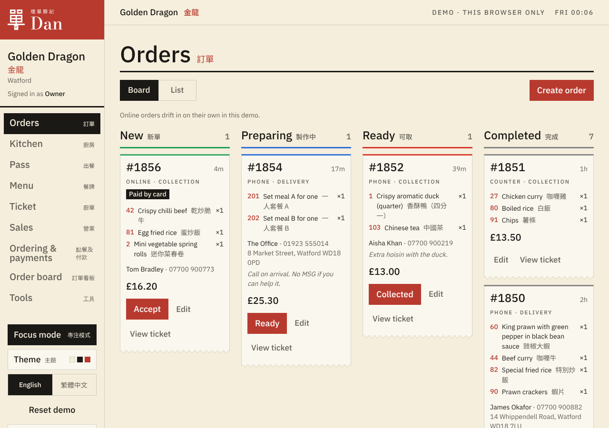
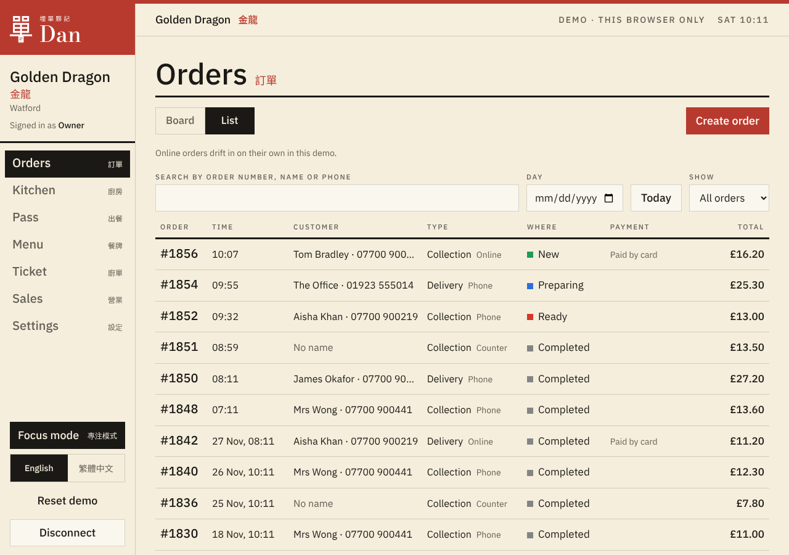
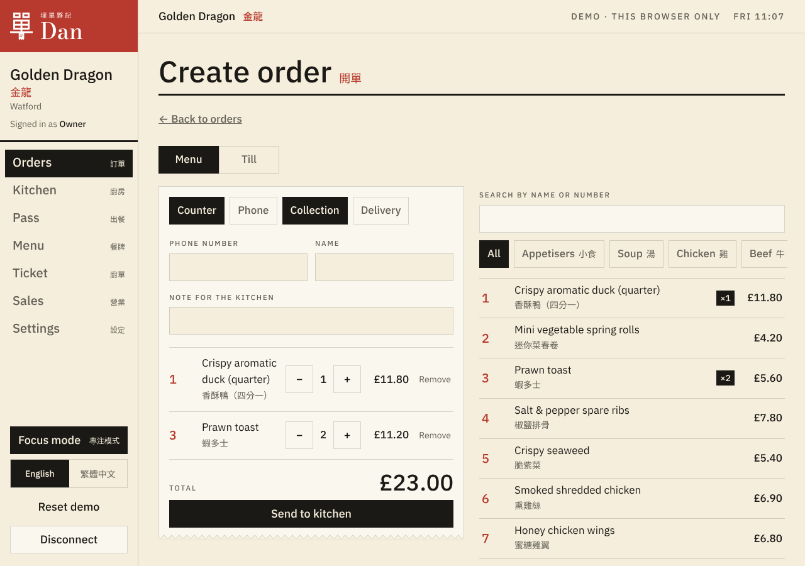
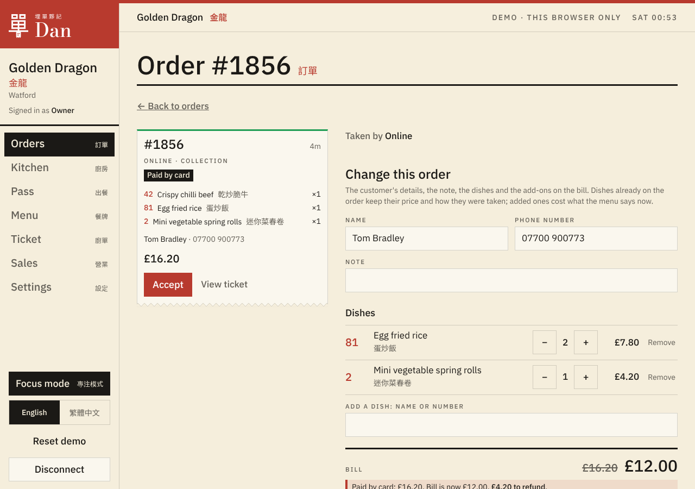
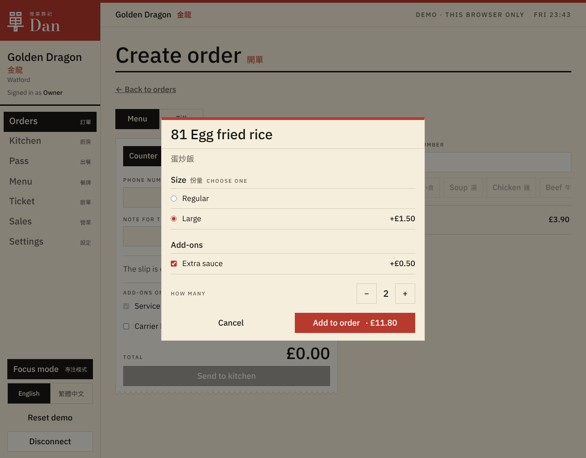
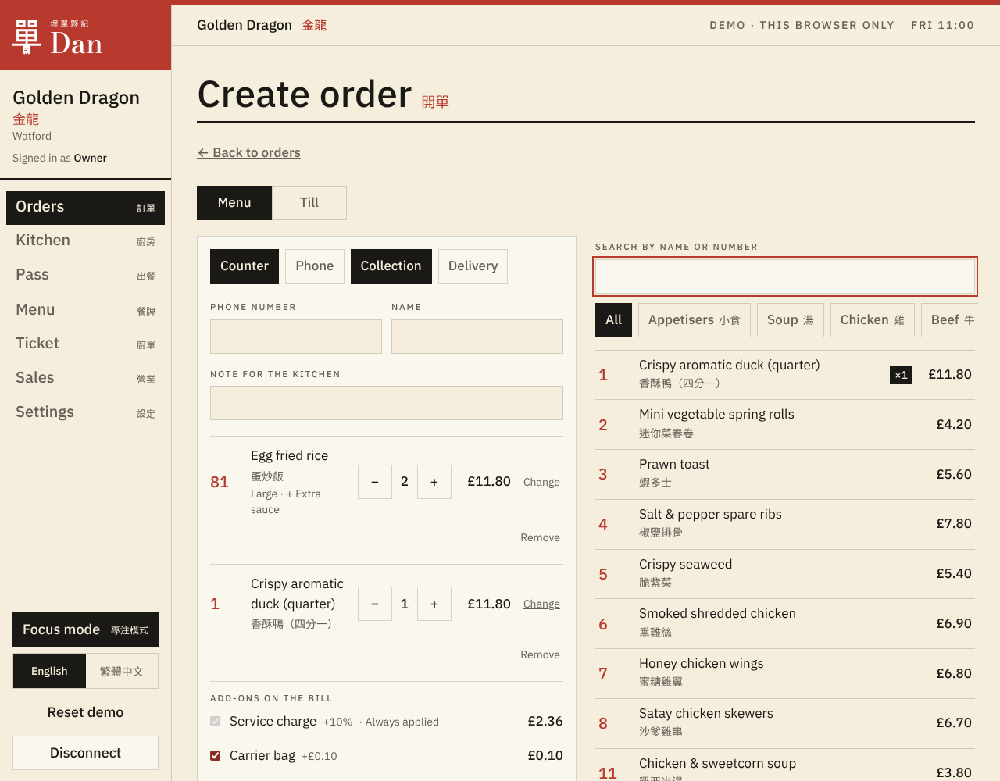
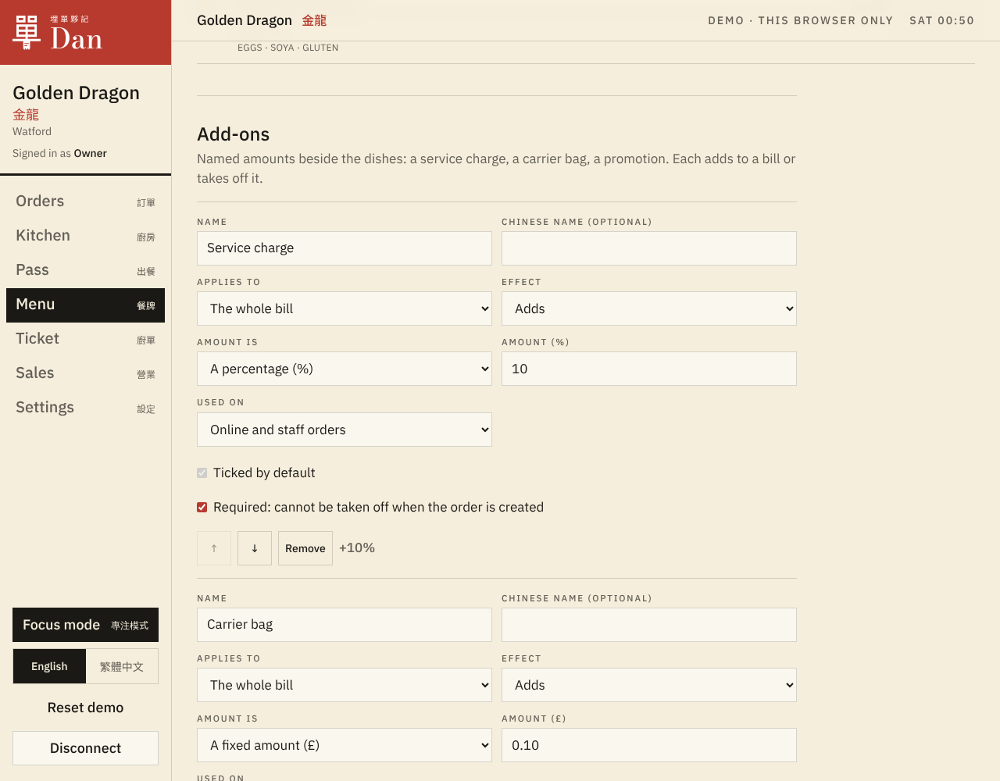
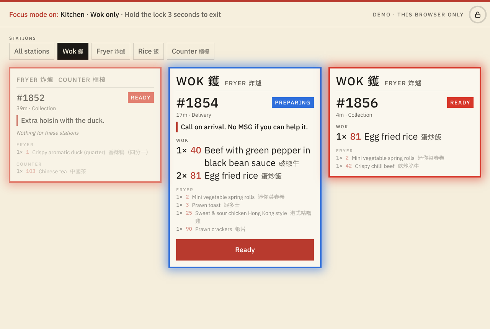

# Dan

Dan (單, Cantonese *daan1*, an order slip) is the counter for a Chinese takeaway. A shop lives in the Dan cloud, and can also run its own Dan server on the premises. This repository is the web client — the glass on the counter — served at [my.dan.partners](https://my.dan.partners). The name is a pun on 埋單夥記.

The client signs in to a shop in the **Dan cloud**, connects to a shop's own server, or opens a full mock of **Golden Dragon, Watford** that lives entirely in the browser.












## Run

```bash
npm install
npm run dev
```

Open [http://localhost:3000](http://localhost:3000).

- **Sign in** (the first page) is for a shop in the Dan cloud: the owner's email and password, or the shop's address name and the counter PIN. Below it, anyone can **join the waiting list** with an email. See [Accounts in the Dan cloud](#accounts-in-the-dan-cloud).
- **Connect** (`/connect`, linked from the first page) asks for the shop server URL (`http://192.168.1.20:2283`, `https://goldendragon.dan.partners`, …), sends a GraphQL `ping` to `<server>/graphql`, remembers recent servers, then asks for email and password or a counter PIN.
- **Try the demo / 試用示範** signs into Golden Dragon with no backend. Orders, the menu, stamp cards and today’s takings persist in `localStorage`. **Reset demo** in the side menu loads the shop again.

```bash
npm test          # mock server, GraphQL client, theme colours and contrast
npm run test:e2e  # connect → demo → till → kitchen ticket, and themes
npm run lint
npm run build
```

## Deploy

**On the shop's machine (how a shop's counter runs it).** The [shop server](https://github.com/DanPartners/server)'s `compose.yaml` builds this repo, pinned to a tested commit, from the `Dockerfile` here (a standalone Next.js build on Node 22, non-root). Its front serves the dashboard and the staff API together at `http://<shop machine>:3000` on the shop's network. The tablets open that address, so the counter works with no internet: every page, font and request stays on the shop's network. The sign-in page fills in the shop server by itself there.

**Hosted (for the owner away from the shop, and the demo).** The app is a Next.js project with no required environment variables (`NEXT_PUBLIC_DAN_CLOUD_URL` is only for a cloud other than `https://cloud.dan.partners`). On Vercel, import this repository (framework preset Next.js) and attach the domain `my.dan.partners`. The demo works as soon as the deployment is live. `https://my.dan.partners/shop/orders?demo=1` opens the demo straight on the orders board (the website links there); someone already signed in to a shop stays signed in.

## Accounts in the Dan cloud

A business joins in the [Dan cloud](https://github.com/DanPartners/cloud), with no machine to set up. The dashboard talks to the cloud's own address for this (`NEXT_PUBLIC_DAN_CLOUD_URL` at build time; `https://cloud.dan.partners` when unset), then to the shop's own staff API, which the cloud hands back.

- **Waiting list.** The first page takes an email (`POST /v1/waitlist`). The answer is the same whoever asks.
- **Invite.** Dan picks people from the list and sends each a one-time link by hand (`dan-cloud waitlist invite <email>`): `/join#<token>`. The page takes the token out of the address bar, then asks for a name, a password (at least 10 characters), the shop's name, its address name (checked as it is typed) and a template: **online shop** (three columns: New, Ready, Completed; no stations, no views, no sounds) or **restaurant** (New, Preparing, Ready, Completed; four stations; Kitchen and Pass; the kitchen's 叮). Everything a template sets can be changed later on the Order board page. The shop is made and the owner is signed in, on an empty menu.
- **Sign in.** Email and password find the owner's shop (`POST /v1/login`). A counter tablet signs in with the shop's address name and PIN; the device remembers the address name.
- **Forgotten password.** Dan sends a one-time link (`dan-cloud shop reset-link <email>`): `/reset#<token>`. Choosing a new password ends the old sign-ins.
- **A shop that lives in the cloud** has one server. The status corner shows one light, "Dan cloud", and there is nothing to sync or switch to.
- **Building the menu** (owner): on Menu, **Add dish**, **Edit categories** (add, rename, put in order, remove an empty one), and **Remove dish** inside a dish. One name is enough for a dish or a category; it is used for both languages. The demo does the same in the browser.
- **Stations** (owner, in Settings, Order flow): add, rename, reorder and remove the shop's stations, or have none. A station with dishes on it cannot be removed. The dish form, the kitchen's filter, tickets and printers follow the list. The counter PIN sees it read-only. `e2e/stations.spec.ts` covers the demo, the PIN and a cloud restaurant with no stations.
- **Views** (owner, in Settings, Order flow): see [Views](#views) below.
- **Settings, Shop** (owner): **Shop details** (name, Chinese name, address, town, phone) and **Counter PIN** (set or change it; tablets on the old PIN are signed out).
- Passwords are cleared from a form once it has signed in, because a page already visited can stay in memory.

`e2e/accounts.spec.ts` runs the whole of it against a real cloud: waiting list, an invite made with the cloud's command, joining, building a menu, an order numbered 1, signing in again by email and by PIN, and a reset link. It is skipped unless you point it at a cloud that allows this dashboard's address, with the dashboard built for that cloud:

```bash
NEXT_PUBLIC_DAN_CLOUD_URL=http://localhost:2290 npm run dev
```

```bash
DAN_E2E_ACCOUNTS=1 DAN_E2E_CLOUD=http://localhost:2290 DAN_E2E_CLOUD_BIN=../cloud/target/debug/dan-cloud DAN_E2E_CLOUD_MONGODB_URI=mongodb://127.0.0.1:27017 DAN_E2E_CLOUD_DATABASE=dan_cloud npx playwright test accounts
```

The cloud limits how often one caller may use these pages (5 waiting-list entries an hour), so many reruns in a row are refused, plainly.

## The shop server

A shop that takes the shop server (a paid extra, DAN-34) runs [DanPartners/server](https://github.com/DanPartners/server) on a machine in the shop: a Rust server with a local MongoDB, started from the shop's key and run with Docker Compose. It serves this dashboard on the shop's network. The dashboard talks to it over **GraphQL** at `<server>/graphql`. The wire contract is the server's [`schema.graphql`](https://github.com/DanPartners/server/blob/main/schema.graphql); this repo's side is [`src/lib/graphql-client.ts`](src/lib/graphql-client.ts), which implements `DanClient` from [`src/lib/types.ts`](src/lib/types.ts). Screens only see `DanClient`, so the browser demo and a real server look the same to them.

- **Two servers.** The connect page (`/connect`) asks only for the **shop server**, and fills in the machine's own local address when it is opened from the machine (`http://<shop machine>:3000`). It asks nothing about the Dan cloud: the machine knows its cloud from its key and says it in `ping` (`cloudUrl`). Signing in signs in to both. The counter uses the shop server first. (A shop server from before DAN-34 does not say it, and its tablets then have no cloud.)
- **Settings are the cloud's, orders the machine's** (RK, 27 Nov 2026, DAN-34). On a shop server started from a key, the owner's settings (everything under Settings, and the menu: dishes, prices, categories, options, add-ons) are saved to the Dan cloud, and the machine takes them within seconds and tells every tablet. They can be saved only while the machine is connected to the cloud with a valid key (`syncStatus.connected`, within the last 30 seconds). Otherwise every section of Settings except Tables & printers, and the dish and add-on editors, are read only, with a line saying why: the machine is not connected, the key is not valid, or (a tablet signed in before the machine first reached the cloud) sign out and in again. Orders, sold out and the printers always stay on the machine. The rule is `settingsAccess` in [`src/lib/server-health.ts`](src/lib/server-health.ts). With the counter switched to the cloud (the machine down), settings save to the cloud directly.
- **Key not valid.** When the cloud refuses the machine's key (Dan deactivated it), the machine carries on alone, as when the internet is down. Every tablet, the PIN included, shows "This shop server's key is not valid" at the top, and the status corner says "Key not valid". It cannot be hidden.
- **Switch-over.** Both servers are checked every 10 seconds (every 3 while something is wrong). If the shop server misses 3 checks in a row while the cloud answers, every request and the live channel move to the cloud, and a strip says so. When the shop server answers 2 checks in a row and reports it has caught up with the cloud, the counter goes back. The rule is `serverInUse` in [`src/lib/server-links.ts`](src/lib/server-links.ts). Orders taken on the cloud are numbered from 9001 if the shop server cannot number them, and sync to it when it returns.
  - **Limit:** the counter page is served by the shop machine. A tablet that already has it open carries on; one that reloads while the machine is down has nothing to reload. Until the counter is cached in the browser, open `my.dan.partners` on any device and enter the shop's cloud address as the shop server.
- **Status, top right.** A light for each server (green connected, amber reconnecting, red offline), the one in use underlined, and the sync line ("Synced", "Waiting to sync: 12 changes", "Key not valid", or "Sync not running yet"). Tap for the addresses and the last sync. Both servers are checked every 10 seconds; a server is offline after three missed checks. Any staff member sees it.
- **Connect** sends `ping`. The answer must say `product: "dan"`. A server with no shop yet answers `not_set_up`, and the connect screen says so.
- **Sign in** with the owner's email and password, or the counter PIN. The token goes in `Authorization: Bearer <token>`.
- **Live, over a WebSocket.** After sign-in the dashboard opens the server's live channel (`<server>/graphql/ws`, the standard `graphql-transport-ws` protocol) and sends its token in the first message. New and moved orders arrive at once, in full; a menu, stamp card or theme change arrives as a notice and the dashboard fetches just that part. Nothing polls. If the connection drops, the dashboard shows that the shop server is not answering, reconnects by itself, and fetches everything again so nothing is missed. The client is [`src/lib/live.ts`](src/lib/live.ts), shared with the customer site. A new online order shows a banner, as in the demo.
- **The counter PIN runs service**: orders, the till, tickets, stamp cards, and marking dishes sold out. Only the owner edits dishes and prices or sees sales. The server enforces this. The dashboard hides the Sales link, makes dish rows read-only and explains why, so nobody hits an error mid-rush. The side menu shows who is signed in.
- **Online orders** from the customer site show how they are paid: "Paid by card", or "To pay at the shop" with the amount, on the docket and on the ticket.
- **Errors** carry the server's code (`forbidden`, `locked`, `sold_out` …), and [`src/lib/i18n.ts`](src/lib/i18n.ts) turns it into copy.
- The server must list a hosted dashboard's address in `DAN_ALLOWED_ORIGINS`, or the browser refuses to connect. The dashboard served from the shop's own machine needs no entry: the server accepts a page from its own local address.

Prices are integer pence. Times are ISO-8601. The sales day and week are calendar days in `Europe/London`, Monday-start.

**Known gap:** the hosted dashboard is HTTPS, and browsers block an HTTPS page from calling a plain `http://` address on the shop's network. In the shop, use the dashboard served by the shop's machine (`http://<shop machine>:3000`), which has no such problem.

### Testing against a real server

`e2e/real-server.spec.ts` drives the dashboard against a running server, as the counter and as the owner. It is skipped unless you point it at one, and it changes data, so never use a shop in service. Start the server from a test shop's key (`dan-server setup`), with `DAN_ALLOWED_ORIGINS=http://localhost:3000`, then:

```bash
DAN_E2E_SERVER_URL=http://127.0.0.1:2283 DAN_E2E_OWNER_EMAIL=you@example.com DAN_E2E_OWNER_PASSWORD='…' DAN_E2E_PIN='…' npx playwright test real-server
```

`e2e/switch-over.spec.ts` stops a shop server that syncs to a cloud, takes an order through the cloud, starts it again and checks the counter goes back with the order. Give it the cloud address and commands that stop and start that shop server:

```bash
DAN_E2E_SERVER_URL=http://127.0.0.1:2283 DAN_E2E_CLOUD_URL=http://goldendragon.localhost:2290/staff DAN_E2E_PIN='…' DAN_E2E_SHOP_STOP='…' DAN_E2E_SHOP_START='…' npx playwright test switch-over
```

With the stop and start commands set, the tests run one at a time, so nothing else uses the shop server while it is stopped.

`e2e/shop-server.spec.ts` is the shop server with its settings in the cloud (DAN-34): the owner signs in on the machine without typing the cloud, the machine refuses a settings change itself, and a change saved through the dashboard reaches the cloud and comes back to the machine. With commands that stop and start the cloud (`DAN_E2E_CLOUD_STOP`, `DAN_E2E_CLOUD_START`) it also checks that settings and the menu go read only while the machine is not connected, that sold out and Tables & printers still work, and that saving comes back with the cloud. With a shop server whose key the cloud refuses (`DAN_E2E_REFUSED_SERVER_URL`, `DAN_E2E_REFUSED_PIN`) it checks the key warning. The tests about a shop with no cloud (in `real-server.spec.ts` and `photos.spec.ts`) skip themselves on a shop server with a key: point them at one without.

`e2e/touch.spec.ts` runs the demo on an iPad-sized touch screen: a double tap moves an order one step, the lock is held with a finger, nothing is selected by a long press, and controls are big enough.

`e2e/orders.spec.ts` uses the order list in the demo (search, day, status, a row's docket), creates orders from the menu and on the keypad, and follows the old Till address. With a real shop server the counter PIN takes an order from the menu and finds it in the shop's own order history, a page at a time.

The same file changes an order as the owner in the demo (details, dishes, what was paid, the record, a move back, a cancelled order). With the owner's sign-in and the shop's staff API in the cloud (`DAN_E2E_OWNER_EMAIL`, `DAN_E2E_OWNER_PASSWORD`, `DAN_E2E_CLOUD_URL`) it runs three browsers at once: the owner changes an order on the shop server, the counter PIN sees it marked and can change nothing, the change and its record arrive in the cloud, and a move back made in the cloud reaches the shop's tablets with no reload. `e2e/printing.spec.ts` checks the CHANGED ticket comes out of the printer.

It also cancels orders as the owner (the refund said first, a card given back what was taken, a completed order), and in the three-browser run the cancel reaches the counter and the cloud. `e2e/printing.spec.ts` checks the CANCELLED ticket prints.

`e2e/refund.spec.ts` is the card refund end to end, with the stand-in Stripe in [`e2e/stand-ins/fake-stripe.mjs`](e2e/stand-ins/fake-stripe.mjs) (never the real Stripe): a customer's card order is paid, the owner cancels it from its page, the cloud refunds it once and in full with Dan's fee returned, and the tablet shows it with no reload; then a refund that fails is shown on the order and on the Orders page. Run it by itself with `DAN_E2E_REFUND=1` (see the top of the file): the cloud limits orders from one address, and a full run is already close to that.

`e2e/views.spec.ts` adds a view in the demo, locks a tablet to it, gives it a sound, changes the board under it and removes it. With a real shop server the counter PIN sees views read-only; with a Dan cloud (as `e2e/accounts.spec.ts` needs) an online shop starts with none and a restaurant with Kitchen and Pass.

`e2e/focus.spec.ts` locks the demo to the kitchen. With `DAN_E2E_PUBLIC_URL` (the shop's customer API on the cloud) it also places a table's order and follows it on a kitchen tablet and a pass tablet. The customer API limits orders from one address, so a rerun a minute later may be refused; the test says so.

## In the browser

| Screen | What it does |
| --- | --- |
| Orders | New, preparing, ready, completed. Collection, delivery, and eat in (from a table's link on the customer site: the docket and ticket show "Eat in · Table 3"). Accept, mark ready, then collected, delivered or served. Stamp a phone number from the docket. |
| Orders, as a list | **Board** or **List**, kept per device. The list is every order the shop has, newest first, 50 at a time: number, time, customer, type, where it is on the board, payment, total. Search by order number, part of a name, or digits of a phone; narrow to a day and to open, completed or cancelled orders. A row opens the order's docket, with the same buttons as the board. A new order appears at the top by itself. Asked from the server (`orderHistory`); a shop server from before the list gets one made from the latest 200 orders. |
| Create order | On the Orders page (**Create order**; on a phone, **New order** in the bottom bar), for the owner and the counter PIN. Two ways to add dishes, kept per device. **Menu**: tap dishes by category, or search by name or number; each tap adds one. **Till**: key a dish number: `2`, `×`, `81`, Add is two egg fried rice; the number keys work too. A dish with options asks how it is taken first, either way (see [Options and add-ons](#options-and-add-ons)); the slip shows what was chosen under each dish, with **Change**, and the add-ons on the bill above the total. Counter or phone, collection or delivery, the customer's details and a note. The form empties after each order. The button says **Send to kitchen** where the shop has a "make" view, and **Place order** where it has none. The old `/shop/till` address opens it in till mode. With the till switched off under Ordering & payments, Create order goes. |
| One order | `/shop/orders/<id>`: the order's docket, for anyone signed in. **The owner** (never the counter PIN) also gets **Change this order** (name, phone, address, an eat-in order's table, the note, the dishes: quantities, remove, add by name or number, and the add-ons on the bill), **Move the ticket** (to any column, back included; a completed order is reopened by moving it back) **Cancel this order**, and the **Record of changes**. The bill is shown as it will be before saving; dishes already on the order keep their price, added ones cost what the menu says now. Collection or delivery is not changed here. The address is locked while a courier is booked. A cancelled order cannot be changed. The owner opens it with **Edit** on a docket. |
| Changed orders | A docket the owner has changed says **Changed**, for everyone. When the bill of an order already paid has moved, the docket says what was taken, the bill now, and the difference to collect or refund ("Paid by card: £16.20. Bill is now £12.00. £4.20 to refund."). Dan charges and refunds nothing by itself: the owner takes the extra at the counter, or refunds in Stripe. |
| Cancelling an order | **Cancel this order** on the order's page, for the owner only (the server refuses the counter PIN, and the delivery-problem box no longer offers it Cancel). Any order not already cancelled, a completed one included. The page says first what will happen to money paid online: a card payment is refunded in full by the Dan cloud, through Stripe, for what was taken; a bank transfer is the owner's to send back; otherwise there is nothing to refund. The second tap names the order and the refund ("Yes, cancel #1856 and refund £16.20"), with **Keep the order** beside it. It cannot be undone. Afterwards the docket says **Cancelled** and where the money stands: being refunded, refunded, or "The card refund failed. Refund this in Stripe". A failed refund is also flagged at the top of the Orders page. An order cancelled before it was finished prints a CANCELLED ticket in the kitchen. The cancel is in the record of changes. |
| Bank transfers | With bank transfer on, the orders board lists transfers waiting for payment (held in the Dan cloud, so the dashboard must be connected to it): reference, amount, customer, when it lapses. **Paid** sends the order to the board, "Paid by bank transfer"; **Not received** tells the customer. Unmarked, it lapses after 30 minutes. Dockets also show "Delivery · Shop delivery" or "Uber Direct", the delivery fee, and cash on delivery. |
| Printing | When a printer is not answering, or tickets were given up after 30 minutes, every tablet shows a red strip (which printer, how many tickets) with **Retry now** and, after 30 minutes, **Dismiss**. **Reprint** on the kitchen screen, the orders board and the ticket page prints an order again (shown when the shop has printers). |
| Views | The owner's screens for one part of the order flow, each in the menu after Till. A restaurant starts with **Kitchen** and **Pass**; an online shop with none. See [Views](#views). |
| Menu | English and Traditional Chinese, dish numbers, allergens, prices in pounds. Edit a dish. Toggle sold out. A dish's **options** (in its editor) and the shop's **add-ons** (under the menu): see [Options and add-ons](#options-and-add-ons). **Dish photos** (owner): Add, Replace or Remove in the dish's editor, with the tablet's camera or photos. Added only while the dashboard is connected to the Dan cloud: the photo is shrunk on the device (and turned upright, HEIC included where the browser reads it), then sent to the cloud, which checks it, strips its metadata and keeps it. Shown as a thumbnail here, on the till beside the dish being keyed and on the slip, and on the customer site. Without internet the counter simply shows none. A shop server from before photos still works: the menu is asked for again without them. |
| Ticket | An 80mm bill, by station, in Chinese and English. One slip, or torn by station. What was chosen for a dish is under it; the bill's add-ons are above the total. Print uses the browser. |
| Stamps | Customers by phone. Ten stamps, then a reward. **Switched off for now** (`FEATURES.stamps` in [`src/lib/features.ts`](src/lib/features.ts)): hidden everywhere, data kept. |
| Sales | Today and this week. |
| Settings | At the bottom of the menu (in **More** on a phone): every setting of the shop, one page per section, from a list (DAN-33). **Shop**: details, counter PIN, and **Theme** (the dialog that used to sit beside the menu). **Ordering**: order types, ways to pay, delivery fee and minimum, bank details. **Order flow**: board columns, views, sounds, stations. **Tables & printers**: table QR cards and receipt printers. **Integrations**: Stripe and Uber Direct, each with its state and its own page. **Subscription**: Dan's deal and terms. The counter PIN sees **Tables & printers only**. See [Settings](#settings). |

### Options and add-ons

Two things can change what a dish or a bill comes to. The owner sets both on the **Menu** page; the counter PIN sees them read-only.







- **Options** belong to a dish (in its editor): groups of choices such as Size or Extras. A group is **Choose one** (the first choice is the one taken when none is picked) or **Choose any**. A choice has a name in one or both languages, a price change (`1.50` adds, `-0.50` takes off, empty changes nothing) and the allergens it brings. Up to 8 groups a dish and 20 choices a group. A set meal has none.
- **Add-ons** belong to the shop (the list under the menu): a service charge, a carrier bag, a promotion. For each: the whole bill or one dish; adds or takes off; a fixed amount or a percentage; **Ticked by default**; **Required** (always applied, and cannot be taken off when the order is created); and where it is used: online orders, staff orders, or both. The amount is shown as an order will show it ("+10%", "-£1.00") before it is saved. Up to 20.
- **Taking an order.** A dish with options opens a chooser (choices, the add-ons for a dish, how many) before it goes on the slip. A dish without options goes straight on with the add-ons ticked by default, and **Change** on its line opens the same chooser. This is deliberate: a tap still adds a plain dish at once, and nothing that needs a decision (a size) is added without one. The same dish taken two ways is two lines. The bill's add-ons are ticked on the slip; a required one is shown ticked and locked. Staff are offered the add-ons for staff orders, never the online-only ones.
- **Afterwards, only the owner.** On the order's page the owner can take a required add-on off the bill or put one on, and add a dish with any add-on. A line already on the order keeps how it was taken; to change it, remove it and add the dish again (at the menu's price now). Every such change is in the record.
- **Where they show.** Under the dish on the board's dockets, the kitchen and pass views, the ticket page and the printed tickets. The bill's add-ons are on the ticket page and the whole-order printed ticket, above the total.
- **One rule for money.** The shop server prices every order (`src/pricing.rs` there). [`src/lib/pricing.ts`](src/lib/pricing.ts) is the same rule, step for step, so the slip can show the bill before it is sent and the demo behaves like a real shop; [`src/lib/pricing.test.ts`](src/lib/pricing.test.ts) runs the server's own cases with the server's own figures. An order's figures always come from the server.
- **Older shop servers.** A shop with no options and no add-ons sends orders exactly as before, so a shop server from before DAN-32 still works; it is asked for orders and dishes without the new fields, and has no add-ons.
- Dan does not work out VAT. How a charge or a discount is taxed is for the shop and its accountant.

### The record of changes

Every change the owner makes to an order is recorded on the server: who, when, each detail before and after (the bill's add-ons among them), each dish's quantity before and after (with how it was taken, where a dish is on the order two ways), and the bill before and after. A move of the ticket by the owner is recorded too. The record is shown, newest first, on the order's page, to the owner only.

- Nothing in the dashboard removes or edits a record, and the server has no call for it. This is deliberate: a till that could quietly rewrite its sales would be a tool for hiding them.
- When the dishes change on an order that is not finished, the shop's machine prints a ticket marked CHANGED (see the server README).
- The same rules run in the browser ([`src/lib/order-edit.ts`](src/lib/order-edit.ts)) to show the bill before saving, and for the demo, which keeps its own record in this browser. The server decides.
- A shop server from before this is asked for orders without the new fields; the Edit page then says what the server answers.

### Settings

Decided 27 Nov 2026 (RK), built in DAN-33. Every setting of the shop in one place, `/shop/settings`: a list of sections, each its own page.

| Section | Address | What is there |
|---|---|---|
| Shop | `/shop/settings/shop` | Shop details, counter PIN, theme. |
| Ordering | `/shop/settings/ordering` | Order types, ways to pay, delivery fee and minimum, bank details. While Uber Direct or Stripe is not connected, its switch is greyed with a link to connect it. |
| Order flow | `/shop/settings/flow` | Board columns, views, sounds, stations. |
| Tables & printers | `/shop/settings/tables` | Table QR cards; receipt printers (set up on the shop's machine only). |
| Integrations | `/shop/settings/integrations` | Stripe (`/stripe`) and Uber Direct (`/uber`), each with its state: Connected, Needs attention, Not connected, or Needs the Dan cloud. |
| Subscription | `/shop/settings/subscription` | The shop's deal on card payments in plain words (DAN-41: Dan's fee comes from Stripe through the cloud; today "Launch offer: your first 100 card orders each month are free of any Dan fee, until ... Otherwise, Dan's fee is 0.5% + 10p of each card payment, at most £1.00 per order.") with this month's free card orders used (or, on a deal accepted before, the free card orders used), Dan's terms and their acceptance, and "Dan charges nothing else today." (hidden while the shop pays for the shop server). The **shop server** (DAN-35): its prices from Stripe, **Get the shop server** (after Dan's terms are accepted) to Stripe Checkout on Dan's own account, then where it stands (paid and waiting for Dan to set the machine up, on, a failed payment, cancelled and when it ends, ended) and **Manage billing** (Stripe's own page: the card, cancelling). |

- **Stripe** (owner, through the Dan cloud): connect the shop's own account; then whether card payments are on (or waiting for Dan's terms, accepted under Subscription), and whether **Stripe is paying out** to the shop's bank or has payouts **on hold** (it needs something from the owner), with a link to the owner's own Stripe dashboard. Stripe pays card takings straight into the shop's bank; Dan never holds the money. A payout hold makes the integration say Needs attention.
- **The counter PIN** sees Settings with **Tables & printers** only, where it prints table cards and test tickets (RK, 27 Nov 2026). Any other section, opened by its address, says it is the owner's. The server still refuses every owner-only change from the PIN; it still sends the PIN the board, views and ordering switches, which service needs.
- **Old addresses forward**: `/shop/ordering`, `/shop/board`, `/shop/tools` and `/shop/payments` (where Stripe used to send owners back) go to their section, with the address's details. The forward is temporary (307), not permanent, because browsers remember a permanent one for good. See [`src/lib/old-addresses.ts`](src/lib/old-addresses.ts).
- Add-ons stay on the Menu page, beside the dishes.
- **The shop server, bought by the owner** (RK, 27 Nov 2026, DAN-35). Membership is the Free plan; the shop server is the duo setup once plus a monthly fee, at the prices in Stripe, which the cloud reads. Paying does not switch it on: Dan does, once the machine is set up. A failed monthly payment is shown as a warning and nothing switches off; a cancel runs to the end of the month paid. Back from Checkout (`?shopServer=paid`), the page looks again for a few seconds while Stripe's notice arrives. `e2e/shop-server-buy.spec.ts` runs it all against the stand-in Stripe, with Stripe's notices signed as Stripe signs them (`DAN_E2E_STRIPE_BILLING_WEBHOOK_SECRET`).

### Views

A **view** is a screen for one part of the order flow: a kitchen, a pass, a packing bench. The owner makes them in Settings, Order flow. Each has:

- **A name**, in one or two languages. One name is used for both.
- **A look.** **Make**: what to make, large, split by station, oldest first; borders glow in the column's colour (grey once done, kept 15 minutes); a station filter greys and shrinks the rest, nothing is hidden; a tap moves the whole order on. **Hand over**: who it is for, large (the table number, or the name for collection and delivery); served, collected or delivered in one tap.
- **The board columns it shows.** A ticket is on a view while it is in one of those columns.

Each view is in the menu after Till, at `/shop/view/<id>`. Kitchen and Pass are views (`/shop/view/kitchen`, `/shop/view/pass`; the old `/shop/kitchen` and `/shop/pass` lead there). The id is made from the name when the view is first saved and never changes, so a rename keeps locked tablets and sounds. Up to 12 views. The orders board is not a view: it always shows every column.

- **Views follow the board.** A removed column leaves every view. A new column joins each view that showed every column of its kind (a kitchen showing every in-progress column takes a new in-progress one), and the owner can untick it.
- **Removing a view** removes the sounds that played only on it. A tablet open on it says the view is no longer here; a tablet locked to it is unlocked.
- **Reset to starting views** gives a restaurant Kitchen and Pass on today's board, and an online shop none.
- Saved on the server (`views`, `updateViews`, `resetViews`); the demo keeps its own copy in this browser. A shop server from before views is treated as having Kitchen and Pass. Logic in [`src/lib/views.ts`](src/lib/views.ts).

### Focus mode



**Focus mode** locks a tablet to one job: one of the shop's views (Kitchen, Pass, or any the owner added), the Till, or the Orders board. Locked to the Till, the tablet shows Create order with the keypad; locked to the Orders board, it shows the board, not the list. Anyone signed in can turn it on (the Focus mode button). The tablet goes full screen with no menu, a line at the top says what it is locked to ("Focus mode on: Kitchen · Wok only · Hold the lock 3 seconds to exit"), and any other address sends it back. Each ticket starts with what that job needs most: the stations on a make view, the table on a hand-over view and on the board.

- **To leave:** hold the lock in the top right corner for 3 seconds. A tap only says to hold it. It stops accidents; it is not a security lock.
- The lock and the station filter are saved on the tablet, so a reload stays locked. Browsers need a tap to go full screen again: a Full screen button shows until then. iPhones have no full screen for web pages; the simplified screen still applies.
- Signing out unlocks the tablet.
- Done tickets stay 15 minutes from when the tablet saw them finish (after a reload, from when they were placed): orders do not record when they were finished yet (Linear DAN-17).
- **Made for touch.** After a status button is tapped, the kitchen, pass and board ignore action taps for 0.7 seconds ([`src/lib/tap-guard.ts`](src/lib/tap-guard.ts)): Start puts Ready in the same spot, and Served slides the next ticket under the finger, so a double tap must count once. Locked screens have no pull-to-refresh or bounce (a reload leaves full screen) and no text selection or copy menu on a long press; the till's fields still type. Buttons visibly press. Every control on the kitchen and till is at least 44 by 44 pixels. Pinch zoom stays on, for anyone who needs it larger.
- Logic in [`src/lib/focus.ts`](src/lib/focus.ts).


The demo also drops in an online order every so often while the tab is visible. Reset demo puts Golden Dragon back to the seeded service.

On a real shop server with no Dan cloud set up, the owner sees a warning across the top: the shop's data is only on the shop server. It can be hidden for the rest of the day. The counter PIN never sees it.

UI copy is English, with Chinese beside the labels that staff already say. The language control switches the chrome to Traditional Chinese (`zh-Hant`). Strings live in [`src/lib/i18n.ts`](src/lib/i18n.ts); dish names are data, not chrome, and both languages are always stored on the menu.

## Themes

The theme belongs to the **shop**. It is stored on the shop server, and every tablet and the shop's [customer site](https://github.com/DanPartners/customer) use it. **Theme / 主題** is in Settings, Shop (it was beside the menu until DAN-33). Only the owner can change it, because customers see it; the counter PIN does not see it. In the browser demo it stays in the browser.

| View | What it does |
| --- | --- |
| Choose | Six colour presets and Custom, and five typefaces. A choice applies at once, so the counter behind the dialog is the preview. |
| Customise | Three colours (background, text, accent) and where the side menu sits (on the background, the accent, or the text colour). It starts from the theme on screen and becomes Custom at the first change. **Reset to Dan** puts the default back. |

| Preset | Look |
| --- | --- |
| Dan 單 | The default. Ivory paper, near-black ink, vermilion. |
| Seal 印 | Dan with the side menu on vermilion. |
| Ink 墨 | Dark, for evening service. |
| Jade 玉 | Green accent. |
| Porcelain 青花 | White and cobalt. |
| Contrast 高對比 | Black on white, black side menu. |


How it works:

- **Roles, not colours.** Components paint with `paper`, `paper-raised`, `paper-deep`, `ink`, `ink-soft`, `accent`, `accent-deep`, `accent-ink`, `on-accent` and `rule` (for example `bg-paper`, `text-accent-ink`). Do not put a hex value in a component. The roles are declared in [`src/app/globals.css`](src/app/globals.css).
- **Derived and checked.** [`src/lib/theme.ts`](src/lib/theme.ts) derives every role from the three chosen colours and moves any that would be hard to read: body text aims for 7:1 against its background and nothing falls below 4.5:1. The Customise view says when it has done this.
- **The side menu is its own surface.** Inside an element with the `chrome` class the same roles resolve to the side menu's colours, so a button placed there needs no variant.
- **Saved on the shop server.** `updateTheme` (owner only) stores it; every tablet hears about it at once over the live channel, and the connect screen gets it from `ping`. An owner's edit shows at once and is saved half a second after the last change, so dragging a colour picker sends one save. [`src/lib/use-theme.ts`](src/lib/use-theme.ts) holds this.
- **A copy on each tablet.** The last theme is kept in `localStorage` with the rest of `dan.v1`, and a small inline script paints it before React loads, so a reload does not flash the default.
- **Shared with the customer site.** The customer site uses the same `theme.ts` rules and colour roles, so a shop looks the same to staff and customers.
- **Storage is not trusted.** Only six-digit hex colours and known property names are applied, both in the app and in the inline script.
- **Not themed.** The mark stays vermilion and the word "Dan" stays in its serif in every theme. The 80mm ticket stays black on white, on screen and in print.

## Mark and icons

The mark is 單 drawn from flat strokes, with the last stroke falling as a torn receipt. `DanMark` is the seal (white on a vermilion rounded square) and `DanGlyph` is the character alone, both in [`src/components/mark.tsx`](src/components/mark.tsx). The same torn edge finishes order dockets, the till slip and the ticket (`torn` in `globals.css`).

`src/app/icon.svg` is the source. The favicon, the iOS home screen icon and the install icons in `public/icons/` are rendered from it:

```bash
node scripts/render-icons.mjs
```

The brand masters (app icon, Instagram square and circle) and the design language live in the [wiki](https://github.com/DanPartners/wiki), under `Attachments/` and `02-Engineering/Design-System/`.

## Fonts

A typeface is picked in the Theme dialog and works with any colours.

| Typeface | Headings and text | Chinese |
| --- | --- | --- |
| Plex (default) | IBM Plex Sans | Noto Sans TC |
| Inter | Inter | Noto Sans TC |
| DM Sans | DM Sans | Noto Sans TC |
| Source Serif | Source Serif 4 | Noto Serif TC |
| Bodoni | Bodoni Moda headings, Source Serif 4 text | Noto Serif TC |

- Components use `font-display` (headings and labels), the body font, and `font-zh`. Each typeface sets those three in a `[data-typeface]` block in [`src/app/globals.css`](src/app/globals.css). Only the typeface's id is stored.
- **Not themed:** the word "Dan" is the brand wordmark and stays in Bodoni Moda (`font-wordmark`). The ticket stays in IBM Plex Mono (`font-ticket`).
- Latin fonts are loaded through `next/font`. Only Plex and the wordmark are preloaded; the others are fetched when someone picks them.
- Traditional Chinese is a subset of [Noto Sans TC](https://fonts.google.com/noto/specimen/Noto+Sans+TC) and [Noto Serif TC](https://fonts.google.com/noto/specimen/Noto+Serif+TC), shipped in `public/fonts/` under the SIL Open Font License (`OFL-noto-sans-tc.txt`, `OFL.txt`). The subsets hold the characters the app's own copy and demo menu use. Anything else a shop types falls back to the device's Chinese font. After adding Chinese copy, rebuild them:

```bash
pip install fonttools brotli
python3 scripts/subset-zh-fonts.py "NotoSansTC[wght].ttf" "NotoSerifTC[wght].ttf"
```

To add a typeface: load it in `src/app/layout.tsx`, add its id to `TYPEFACE_IDS` in `src/lib/theme.ts`, and add its `[data-typeface]` block.
