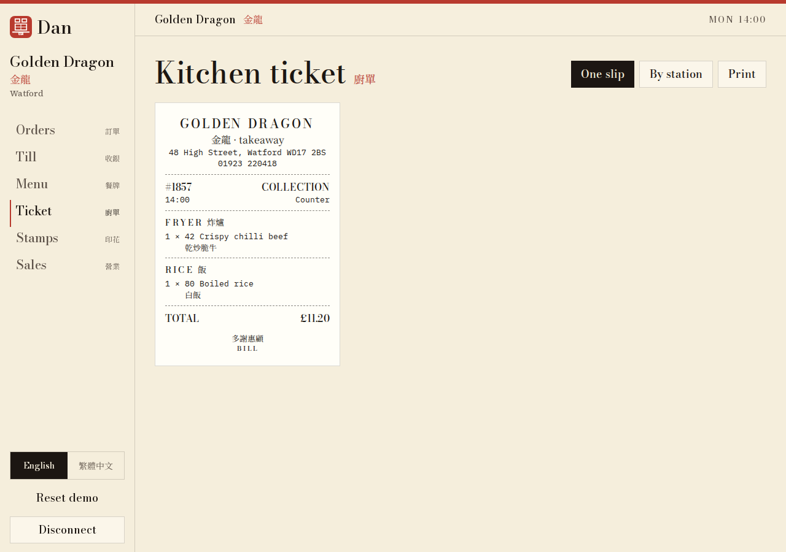

# Dan

Dan (單, Cantonese *daan1*, an order slip) is the counter for a Chinese takeaway. Each shop runs its own Dan server on the premises. This repository is the web client — the glass on the counter — served at [my.dan.partners](https://my.dan.partners). The name is a pun on 埋單夥記.

The client can point at a real shop server, or open a full mock of **Golden Dragon, Watford** that lives entirely in the browser.




## Run

```bash
npm install
npm run dev
```

Open [http://localhost:3000](http://localhost:3000).

- **Connect** asks for the shop server URL (`http://192.168.1.20:2283`, `https://goldendragon.dan.partners`, …), pings `GET /api/server/ping`, remembers recent servers, then asks for email and password or a counter PIN.
- **Try the demo / 試用示範** signs into Golden Dragon with no backend. Orders, the menu, stamp cards and today’s takings persist in `localStorage`. **Reset demo** in the side menu loads the shop again.

```bash
npm test          # mock server and HTTP client
npm run test:e2e  # connect → demo → till → kitchen ticket
npm run lint
npm run build
```

## Deploy

The app is a Next.js project with no required environment variables. On Vercel, import this repository (framework preset Next.js) and attach the domain `my.dan.partners`. The demo works as soon as the deployment is live. A real shop appears when that shop’s server is reachable from the browser and allows this origin.

## What the shop server implements

The dashboard speaks to one origin, the shop. Paths below are relative to that origin (no trailing slash; a base path is allowed, so `https://shop.example/dan` calls `https://shop.example/dan/api/server/ping`).

Requests and responses are JSON. Authenticated routes expect `Authorization: Bearer <token>`. The browser calls the server directly, so the server must send CORS headers for the dashboard origin (`https://my.dan.partners` in production), including `Authorization` and `Content-Type`, and answer `OPTIONS` preflights.

Errors use:

```json
{ "error": { "code": "sold_out", "message": "23 Kung po chicken is sold out." } }
```

The TypeScript contract is `DanClient` in [`src/lib/types.ts`](src/lib/types.ts). Prices are integer pence. Times are ISO-8601. The sales day and week are calendar days in `Europe/London`, Monday-start.

### `GET /api/server/ping`

No auth. Used by the connect screen.

```json
{
  "ok": true,
  "product": "dan",
  "version": "0.1.0",
  "shop": {
    "id": "golden-dragon",
    "name": "Golden Dragon",
    "nameZh": "金龍",
    "address": "48 High Street, Watford WD17 2BS",
    "city": "Watford",
    "phone": "01923 220418"
  },
  "auth": { "password": true, "pin": true }
}
```

`product` must be `"dan"`. Anything else is treated as the wrong server.

### `POST /api/auth/login`

```json
{ "email": "mei@goldendragon.example", "password": "dragon" }
```

or

```json
{ "pin": "2580" }
```

```json
{
  "token": "…",
  "staff": { "id": "mei", "name": "Mei", "role": "owner" },
  "shop": { "id": "golden-dragon", "name": "Golden Dragon", "nameZh": "金龍", "address": "…", "city": "Watford", "phone": "…" }
}
```

`401` with code `unauthorized` when the details are wrong. `POST /api/auth/logout` drops the token.

The password and PIN above belong to the in-browser demo only.

### Menu

`GET /api/menu` → `{ "categories": Category[], "items": MenuItem[] }`

`PATCH /api/menu/items/:id` with any of `number`, `nameEn`, `nameZh`, `descriptionEn`, `pricePence`, `categoryId`, `station`, `allergens`, `soldOut`.

Stations are `wok`, `fryer`, `rice`, `counter`. Allergens are the UK fourteen: `celery`, `gluten`, `crustaceans`, `eggs`, `fish`, `lupin`, `milk`, `molluscs`, `mustard`, `nuts`, `peanuts`, `sesame`, `soya`, `sulphites`.

A set meal has `kind: "set"` and `includes: [{ "number": 25, "qty": 1 }]`. The set has its own price. The kitchen ticket prints the included dishes on their stations.

### Orders

`GET /api/orders` → `{ "orders": Order[] }`

`POST /api/orders`

```json
{
  "source": "counter",
  "fulfilment": "collection",
  "customerName": "Mrs Wong",
  "phone": "07700 900441",
  "address": "",
  "notes": "No onion",
  "lines": [{ "number": 81, "qty": 2 }]
}
```

`source` is `counter`, `phone`, or `online`. `fulfilment` is `collection` or `delivery`. Online orders start as `new`; counter and phone orders start as `preparing`. The server prices the lines. Sold-out dishes return `sold_out`.

`PATCH /api/orders/:id` with `{ "status": "preparing" | "ready" | "completed" }`. Status only moves one step: `new → preparing → ready → completed`.

### Customers and stamps

`GET /api/customers` and `GET /api/customers?phone=07700900441`

`POST /api/customers` with `{ "phone": "07700 900123", "name": "Alex" }` opens a card, or updates the name if that phone already has one.

`POST /api/customers/:phone/stamps` adds one stamp, up to 10. A full card returns `reward_pending`.

`POST /api/customers/:phone/redeem` clears a full card and counts a reward (in the demo, mini spring rolls).

### Sales

`GET /api/sales?range=today` or `range=week`

```json
{
  "range": "today",
  "orderCount": 6,
  "totalPence": 8420,
  "averagePence": 1403,
  "collectionCount": 4,
  "deliveryCount": 2,
  "openCount": 3,
  "topItems": [
    { "number": 81, "nameEn": "Egg fried rice", "nameZh": "蛋炒飯", "qty": 4, "totalPence": 1560 }
  ]
}
```

Takings are every order placed in the period, including ones still on the board. `openCount` is those not yet `completed`.

## In the browser

| Screen | What it does |
| --- | --- |
| Orders | New, preparing, ready, completed. Collection and delivery. Accept, mark ready, collect or deliver. Stamp a phone number from the docket. |
| Till | Key a dish number. `2`, `×`, `81`, Add is two egg fried rice. Send the slip to the kitchen. |
| Menu | English and Traditional Chinese, dish numbers, allergens, prices in pounds. Edit a dish. Toggle sold out. |
| Ticket | An 80mm bill, wok / fryer / rice / counter, in Chinese and English. One slip, or torn by station. Print uses the browser. |
| Stamps | Customers by phone. Ten stamps, then a reward. |
| Sales | Today and this week. |

The demo also drops in an online order every so often while the tab is visible. Reset demo puts Golden Dragon back to the seeded service.

UI copy is English, with Chinese beside the labels that staff already say. The language control switches the chrome to Traditional Chinese (`zh-Hant`). Strings live in [`src/lib/i18n.ts`](src/lib/i18n.ts); dish names are data, not chrome, and both languages are always stored on the menu.

## Fonts

Bodoni Moda and Source Serif 4 are loaded through `next/font`. Traditional Chinese is a subset of [Noto Serif TC](https://fonts.google.com/noto/specimen/Noto+Serif+TC), shipped in `public/fonts/` under the SIL Open Font License (`public/fonts/OFL.txt`).
