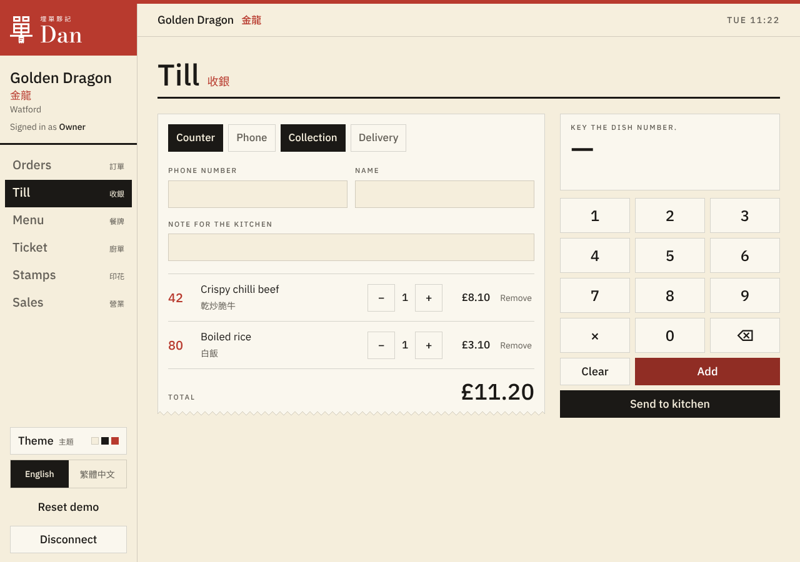
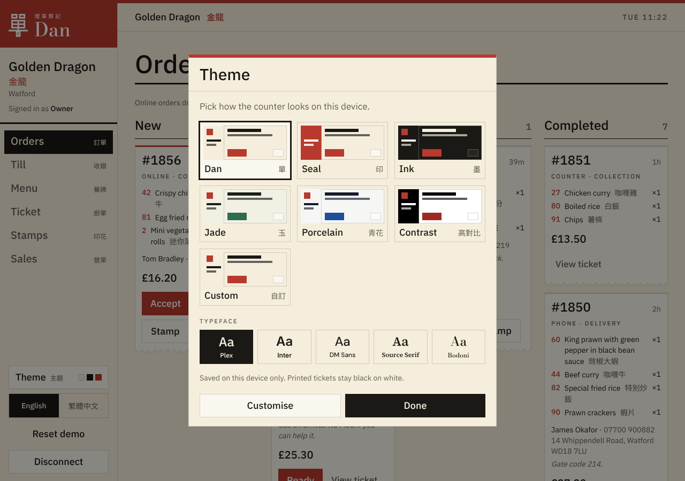

# Dan

Dan (單, Cantonese *daan1*, an order slip) is the counter for a Chinese takeaway. Each shop runs its own Dan server on the premises. This repository is the web client — the glass on the counter — served at [my.dan.partners](https://my.dan.partners). The name is a pun on 埋單夥記.

The client can point at a real shop server, or open a full mock of **Golden Dragon, Watford** that lives entirely in the browser.







## Run

```bash
npm install
npm run dev
```

Open [http://localhost:3000](http://localhost:3000).

- **Connect** asks for the shop server URL (`http://192.168.1.20:2283`, `https://goldendragon.dan.partners`, …), sends a GraphQL `ping` to `<server>/graphql`, remembers recent servers, then asks for email and password or a counter PIN.
- **Try the demo / 試用示範** signs into Golden Dragon with no backend. Orders, the menu, stamp cards and today’s takings persist in `localStorage`. **Reset demo** in the side menu loads the shop again.

```bash
npm test          # mock server, GraphQL client, theme colours and contrast
npm run test:e2e  # connect → demo → till → kitchen ticket, and themes
npm run lint
npm run build
```

## Deploy

The app is a Next.js project with no required environment variables. On Vercel, import this repository (framework preset Next.js) and attach the domain `my.dan.partners`. The demo works as soon as the deployment is live. A real shop appears when that shop’s server is reachable from the browser and allows this origin.

## The shop server

A real shop runs [DanPartners/server](https://github.com/DanPartners/server): a Rust server with a local MongoDB, set up with `dan-server init` and run with Docker Compose. The dashboard talks to it over **GraphQL** at `<server>/graphql`. The wire contract is the server's [`schema.graphql`](https://github.com/DanPartners/server/blob/main/schema.graphql); this repo's side is [`src/lib/graphql-client.ts`](src/lib/graphql-client.ts), which implements `DanClient` from [`src/lib/types.ts`](src/lib/types.ts). Screens only see `DanClient`, so the browser demo and a real server look the same to them.

- **Connect** sends `ping`. The answer must say `product: "dan"`. A server that has not run `init` answers `not_set_up`, and the connect screen says so.
- **Sign in** with the owner's email and password, or the counter PIN. The token goes in `Authorization: Bearer <token>`.
- **The counter PIN runs service**: orders, the till, tickets, stamp cards, and marking dishes sold out. Only the owner edits dishes and prices or sees sales. The server enforces this. The dashboard hides the Sales link, makes dish rows read-only and explains why, so nobody hits an error mid-rush. The side menu shows who is signed in.
- **Errors** carry the server's code (`forbidden`, `locked`, `sold_out` …), and [`src/lib/i18n.ts`](src/lib/i18n.ts) turns it into copy.
- The server must list the dashboard's address in `DAN_ALLOWED_ORIGINS`, or the browser refuses to connect.

Prices are integer pence. Times are ISO-8601. The sales day and week are calendar days in `Europe/London`, Monday-start.

**Known gap:** the hosted dashboard is HTTPS, and browsers block an HTTPS page from calling a plain `http://` address on the shop's network. Until the shop server has HTTPS, connect from a dashboard served over HTTP on the same network (for example `npm run dev` on a laptop in the shop).

### Testing against a real server

`e2e/real-server.spec.ts` drives the dashboard against a running server, as the counter and as the owner. It is skipped unless you point it at one, and it changes data, so never use a shop in service. Set the server up with `dan-server init --demo`, with `DAN_ALLOWED_ORIGINS=http://localhost:3000`, then:

```bash
DAN_E2E_SERVER_URL=http://127.0.0.1:2283 DAN_E2E_OWNER_EMAIL=you@example.com DAN_E2E_OWNER_PASSWORD='…' DAN_E2E_PIN='…' npx playwright test real-server
```

## In the browser

| Screen | What it does |
| --- | --- |
| Orders | New, preparing, ready, completed. Collection and delivery. Accept, mark ready, collect or deliver. Stamp a phone number from the docket. |
| Till | Key a dish number. `2`, `×`, `81`, Add is two egg fried rice. Send the slip to the kitchen. |
| Menu | English and Traditional Chinese, dish numbers, allergens, prices in pounds. Edit a dish. Toggle sold out. |
| Ticket | An 80mm bill, wok / fryer / rice / counter, in Chinese and English. One slip, or torn by station. Print uses the browser. |
| Stamps | Customers by phone. Ten stamps, then a reward. |
| Sales | Today and this week. |

The demo also drops in an online order every so often while the tab is visible. Reset demo puts Golden Dragon back to the seeded service.

UI copy is English, with Chinese beside the labels that staff already say. The language control switches the chrome to Traditional Chinese (`zh-Hant`). Strings live in [`src/lib/i18n.ts`](src/lib/i18n.ts); dish names are data, not chrome, and both languages are always stored on the menu.

## Themes

**Theme / 主題** is in the side menu, in **More** on a phone, and on the connect screen. It opens a dialog with two views.

| View | What it does |
| --- | --- |
| Choose | Six colour presets and Custom, and five typefaces. A choice applies at once, so the counter behind the dialog is the preview. |
| Customise | Three colours (background, text, accent) and where the side menu sits (on the background, the accent, or the text colour). It starts from the theme on screen and becomes Custom at the first change. **Reset to Dan** puts the default back. |

| Preset | Look |
| --- | --- |
| Dan 單 | The default. Ivory paper, near-black ink, vermilion. |
| Seal 印 | Dan with the side menu on vermilion. |
| Ink 墨 | Dark, for evening service. |
| Jade 玉 | Green accent. |
| Porcelain 青花 | White and cobalt. |
| Contrast 高對比 | Black on white, black side menu. |


How it works:

- **Roles, not colours.** Components paint with `paper`, `paper-raised`, `paper-deep`, `ink`, `ink-soft`, `accent`, `accent-deep`, `accent-ink`, `on-accent` and `rule` (for example `bg-paper`, `text-accent-ink`). Do not put a hex value in a component. The roles are declared in [`src/app/globals.css`](src/app/globals.css).
- **Derived and checked.** [`src/lib/theme.ts`](src/lib/theme.ts) derives every role from the three chosen colours and moves any that would be hard to read: body text aims for 7:1 against its background and nothing falls below 4.5:1. The Customise view says when it has done this.
- **The side menu is its own surface.** Inside an element with the `chrome` class the same roles resolve to the side menu's colours, so a button placed there needs no variant.
- **Saved on the device.** The choice lives in `localStorage` with the rest of `dan.v1`. A small inline script paints a saved theme before React loads, so a reload does not flash the default. A theme shared by every tablet in a shop would need an endpoint on the shop server; it is not in `DanClient`.
- **Storage is not trusted.** Only six-digit hex colours and known property names are applied, both in the app and in the inline script.
- **Not themed.** The mark stays vermilion and the word "Dan" stays in its serif in every theme. The 80mm ticket stays black on white, on screen and in print.

## Mark and icons

The mark is 單 drawn from flat strokes, with the last stroke falling as a torn receipt. `DanMark` is the seal (white on a vermilion rounded square) and `DanGlyph` is the character alone, both in [`src/components/mark.tsx`](src/components/mark.tsx). The same torn edge finishes order dockets, the till slip and the ticket (`torn` in `globals.css`).

`src/app/icon.svg` is the source. The favicon, the iOS home screen icon and the install icons in `public/icons/` are rendered from it:

```bash
node scripts/render-icons.mjs
```

The brand masters (app icon, Instagram square and circle) and the design language live in the [wiki](https://github.com/DanPartners/wiki), under `Attachments/` and `02-Engineering/Design-System/`.

## Fonts

A typeface is picked in the Theme dialog and works with any colours.

| Typeface | Headings and text | Chinese |
| --- | --- | --- |
| Plex (default) | IBM Plex Sans | Noto Sans TC |
| Inter | Inter | Noto Sans TC |
| DM Sans | DM Sans | Noto Sans TC |
| Source Serif | Source Serif 4 | Noto Serif TC |
| Bodoni | Bodoni Moda headings, Source Serif 4 text | Noto Serif TC |

- Components use `font-display` (headings and labels), the body font, and `font-zh`. Each typeface sets those three in a `[data-typeface]` block in [`src/app/globals.css`](src/app/globals.css). Only the typeface's id is stored.
- **Not themed:** the word "Dan" is the brand wordmark and stays in Bodoni Moda (`font-wordmark`). The ticket stays in IBM Plex Mono (`font-ticket`).
- Latin fonts are loaded through `next/font`. Only Plex and the wordmark are preloaded; the others are fetched when someone picks them.
- Traditional Chinese is a subset of [Noto Sans TC](https://fonts.google.com/noto/specimen/Noto+Sans+TC) and [Noto Serif TC](https://fonts.google.com/noto/specimen/Noto+Serif+TC), shipped in `public/fonts/` under the SIL Open Font License (`OFL-noto-sans-tc.txt`, `OFL.txt`). The subsets hold the characters the app's own copy and demo menu use. Anything else a shop types falls back to the device's Chinese font. After adding Chinese copy, rebuild them:

```bash
pip install fonttools brotli
python3 scripts/subset-zh-fonts.py "NotoSansTC[wght].ttf" "NotoSerifTC[wght].ttf"
```

To add a typeface: load it in `src/app/layout.tsx`, add its id to `TYPEFACE_IDS` in `src/lib/theme.ts`, and add its `[data-typeface]` block.
